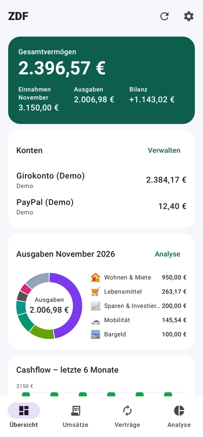
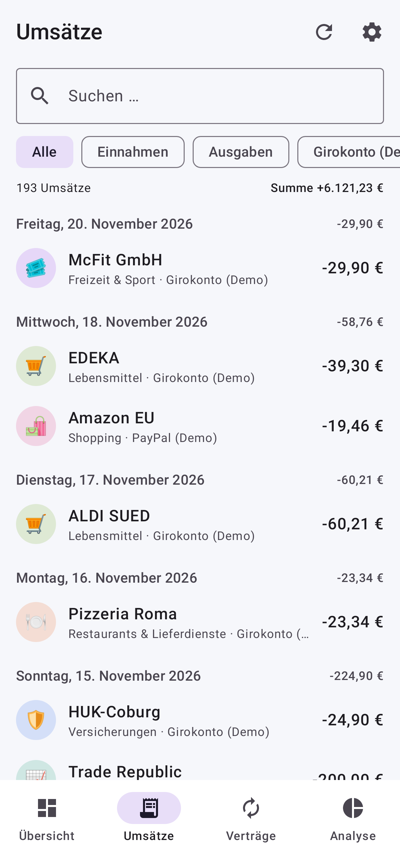
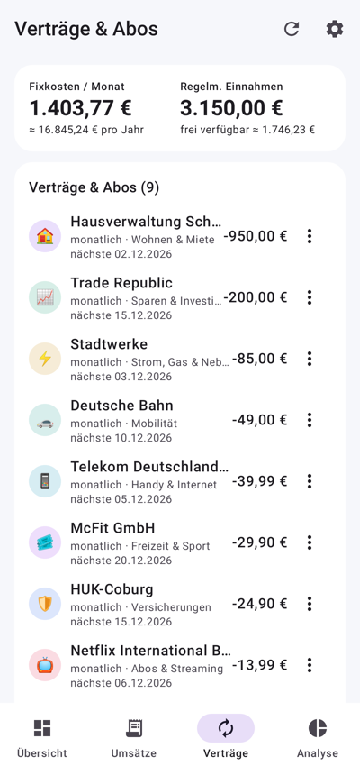
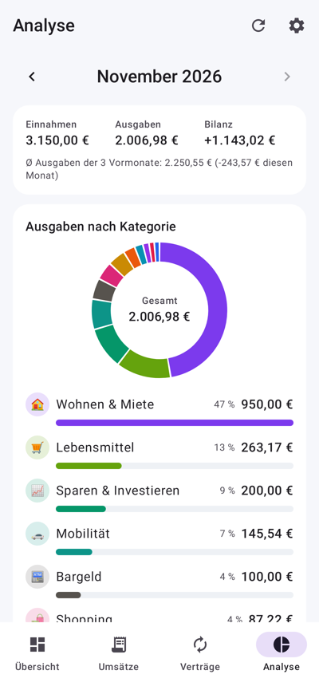
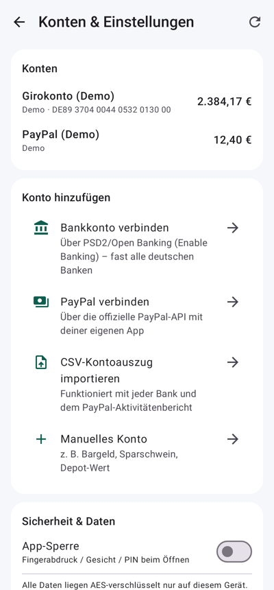

# ZDF – Zahlen, Daten, Fakten

Selbst gehostete Android-App für den Überblick über deine Finanzen – ähnlich wie Finanzguru, aber **ohne fremden Server**.
Alle Daten bleiben AES-256-verschlüsselt auf deinem Handy (Schlüssel im Android Keystore). Kein Tracking, keine Werbung, kein Konto bei uns.

<p>





</p>

## Funktionen

| | |
|---|---|
| **Bankkonten** | Echte Verbindung über PSD2/Open Banking (Enable Banking): Sparkasse, Volksbank, ING, DKB, Commerzbank, N26, comdirect … – Kontostand + Umsätze |
| **PayPal** | Über die offizielle PayPal-REST-API (Transaction Search) oder per CSV-Export |
| **CSV-Import** | Für jede Bank: Trennzeichen, Kodierung und Spalten werden automatisch erkannt. Doppelte Buchungen werden beim erneuten Import übersprungen |
| **Übersicht** | Gesamtvermögen, Einnahmen/Ausgaben/Bilanz des Monats, Prognose zum Monatsende, Cashflow der letzten 6 Monate |
| **Automatische Kategorien** | 20 Kategorien, Hunderte deutsche Händler eingebaut. Eigene Regeln mit „Immer so kategorisieren“ |
| **Verträge & Abos** | Erkennt automatisch wiederkehrende Zahlungen (wöchentlich bis jährlich), Fixkosten pro Monat/Jahr, nächster Abbuchungstermin |
| **Analyse & Budgets** | Ausgaben nach Kategorie mit Monatsvergleich, monatliche Budgets mit Fortschritt |
| **Keine Doppelzählung** | Abbuchungen „PayPal Europe“ vom Girokonto werden als Umbuchung erkannt, gezählt wird der echte Händler aus PayPal |
| **Sicherheit** | Verschlüsselte Speicherung, optionale App-Sperre (Fingerabdruck/PIN), kein Cloud-Backup, JSON-Backup auf Wunsch |

## Installation & automatische Updates

1. Auf dem Handy die Seite **[Releases → Latest](../../releases/latest)** öffnen und die `ZDF-….apk` herunterladen.
2. Öffnen und „Installation aus unbekannten Quellen“ für den Browser erlauben.
3. Fertig – ab jetzt aktualisiert sich ZDF selbst:
   - Beim Öffnen und alle 6 Stunden im Hintergrund (im WLAN) schaut ZDF hier im Repository nach einem neuen Release.
   - Beim ersten Update fragt Android einmalig, ob ZDF Apps installieren darf → erlauben.
   - Ab Android 12 laufen weitere Updates dann ohne Rückfrage im Hintergrund.
   - Abschaltbar unter ⚙️ → *App-Updates*.

Jeder Push auf `main` oder einen `claude/*`-Branch baut über GitHub Actions eine neue Version (`v1.1.<Build-Nr.>`) und veröffentlicht sie als Release.

Zum Ausprobieren ohne Konto: „Erst mal mit Demo-Daten ansehen“.

## Bankkonto verbinden (einmalig ca. 10 Minuten)

Banken in der EU geben Kontodaten nur an **lizenzierte Kontoinformationsdienste** heraus (PSD2). ZDF nutzt dafür
[Enable Banking](https://enablebanking.com) – dort kannst du **deine eigenen Konten kostenlos** verknüpfen
(„restricted production mode“). Deine Bank-Zugangsdaten gibst du nur auf der Seite deiner Bank ein; die Umsätze gehen
direkt von Enable Banking an dein Handy, nicht über einen ZDF-Server.

1. **Callback-Seite aktivieren** (damit die App nach dem Bank-Login automatisch wieder aufgeht):
   GitHub → Repository → *Settings* → *Pages* → Source „Deploy from a branch“, Branch mit dem `docs/`-Ordner wählen.
   Danach ist `https://<dein-name>.github.io/zdf_2/callback.html` erreichbar.
   *(Optional – ohne Pages kopierst du nach dem Login einfach die URL aus dem Browser in die App.)*
2. Auf [enablebanking.com](https://enablebanking.com) registrieren → *Control Panel* → *Applications* → **Register new application**
   - Environment: **Production**
   - Redirect URL: deine Callback-URL aus Schritt 1
   - Der Browser lädt einen **Private Key (.pem)** herunter – gut aufheben.
3. In der Application auf **„Link accounts“** klicken und deine eigenen Konten freischalten (das aktiviert die App kostenlos für dich).
4. In ZDF: ⚙️ → *Bankkonto verbinden* → Application ID eintragen, `.pem` auswählen, Redirect-URL prüfen → *Speichern*.
5. Bank auswählen → im Browser bei deiner Bank anmelden und freigeben → zurück in ZDF. Fertig.

Hinweise:
- Die Freigabe gilt je nach Bank bis zu 180 Tage, danach einmal neu verbinden (gesetzliche PSD2-Vorgabe).
- Beim ersten Abruf werden – je nach Bank – bis zu 2 Jahre Umsätze geladen, mindestens 90 Tage.
- Ältere Umsätze kannst du zusätzlich per CSV-Export deiner Bank in dasselbe Konto importieren.

## PayPal verbinden

**Variante A – API (automatisch):**
1. [developer.paypal.com](https://developer.paypal.com) → mit deinem PayPal-Konto anmelden.
   Die REST-API braucht ein **Geschäftskonto** – ein Privatkonto lässt sich in den PayPal-Einstellungen kostenlos umstellen.
2. *Apps & Credentials* → **Live** → *Create App*.
3. In der App unter *Features* **„Transaction Search“** aktivieren.
4. Client ID + Secret in ZDF unter ⚙️ → *PayPal verbinden* eintragen.

**Variante B – CSV (ohne Geschäftskonto):** PayPal → *Aktivitäten* → *Kontoauszüge* → *Aktivitätsbericht* als CSV herunterladen →
in ZDF ⚙️ → *CSV importieren* → Konto „PayPal“ anlegen. Bei erneutem Import werden nur neue Buchungen übernommen.

## Selbst bauen

```bash
# benötigt JDK 17+ und Android SDK (platform 35)
./gradlew testDebugUnitTest assembleRelease
# → app/build/outputs/apk/release/app-release.apk
```

### Signatur

Updates lassen sich nur installieren, wenn jede Version mit demselben Schlüssel signiert ist.
Der Schlüssel liegt **verschlüsselt** (PKCS#12, AES-256) unter `signing/zdf-release.p12`. Das Passwort steht nur im
GitHub-Secret **`ZDF_SIGNING_PASSWORD`** (*Settings → Secrets and variables → Actions*). Ohne das Secret bricht der Build ab,
damit nie eine falsch signierte Version veröffentlicht wird. Lokal: `ZDF_SIGNING_PASSWORD=… ./gradlew assembleRelease`.

**Passwort gut aufheben** – geht es verloren, muss ein neuer Schlüssel erzeugt und die App einmal neu installiert werden.

## Aufbau

```
app/src/main/java/de/zdf/app/
├── data/         Modelle, verschlüsselter Speicher, Kategorisierung, Vertragserkennung, Auswertungen
├── net/          Enable Banking (JWT/RS256) und PayPal REST-Client
├── importer/     CSV-Import mit automatischer Spaltenerkennung
├── security/     AES-GCM über Android Keystore
├── update/       Selbst-Update aus GitHub-Releases (PackageInstaller + WorkManager)
└── ui/           Jetpack Compose (Übersicht, Umsätze, Verträge, Analyse, Konten)
signing/             verschlüsselter Signaturschlüssel (Passwort nur als GitHub-Secret)
docs/callback.html   Weiterleitung vom Bank-Login zurück in die App (GitHub Pages)
```

## Datenschutz

- Keine Analyse-/Tracking-Bibliotheken, keine Werbung.
- Netzwerkzugriffe ausschließlich zu `api.enablebanking.com` und `api-m.paypal.com` (nur wenn eingerichtet) sowie zu `api.github.com`/`github.com` für die Update-Prüfung dieses Repositorys.
- Android-Cloud-Backup ist deaktiviert; Backups machst du bewusst selbst (⚙️ → Backup exportieren).
